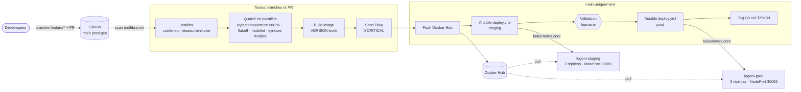

# Rapport – Chaîne CI/CD Legeni WebApp « du commit à la production »

**Auteur :** EVINA ZE ROMARIC – **Dépôt :** https://github.com/nedstudio237-cmd/legeni-webapp
**Image :** https://hub.docker.com/r/nedstudio/legeni-webapp

## 1. Architecture

**Infrastructure (option A) :** une VM Ubuntu 24.04 (4 vCPU, 8 Go). Jenkins tourne en conteneur, sur le réseau Docker `minikube` (IP fixe 192.168.49.10) : il joint directement l'API du cluster (`https://192.168.49.2:8443`) et pilote le démon Docker de l'hôte par le socket. Toute cette infrastructure est décrite dans `ansible/provision.yml`.

## 2. Choix techniques

| Sujet | Choix | Justification |
|---|---|---|
| Image | Dockerfile multi-stage `base` → `test` (flake8 + pytest) → `runtime` | les tests échouent **avant** toute image de production ; image finale sans outils de test |
| Sécurité image | utilisateur `appuser` (UID 10001), `HEALTHCHECK`, `CMD` forme exec (gunicorn PID 1 reçoit SIGTERM) | exigences Lot 1 ; arrêt propre pendant les rolling updates |
| Version | `VERSION` (sémantique) + numéro de build → `1.1.0-14` | traçabilité : on sait quel commit/build tourne ; jamais `latest` (refusé par un `assert` dans `deploy.yml`) |
| IaC | rôles `docker` (réutilisé du cours), `minikube`, `jenkins` | réutilisables, variables dans `defaults/`, idempotents (`changed=0` au 2ᵉ passage) |
| Jenkins | image du TP 3.1 figée sur `jenkins/jenkins:2.580.2-lts-jdk21` | une reconstruction ne casse pas les plugins (problème vécu au TP 3.1) |
| Manifests | un template Jinja2 unique, paramètres dans `vars/staging.yml` / `vars/prod.yml` | « mêmes manifests, paramètres différents » ; secrets fournis par Vault |
| Redis | StatefulSet + `volumeClaimTemplates` (PVC 1 Gi) + Secret | données persistantes ; mot de passe hors des manifests |
| Zéro coupure | `maxUnavailable: 0`, `maxSurge: 1`, `readinessProbe /ready`, **`preStop: sleep 5`** | aucun Pod retiré avant qu'un nouveau soit prêt ; le Pod qui s'arrête finit de servir le temps que le Service le retire |
| Rollback | `block/rescue` Ansible + `k8s_rollback` + `fail` | retour automatique à la révision précédente **et** build rouge |
| Secrets | Ansible Vault (`vars/vault.yml` chiffré AES256), credentials Jenkins `registry-credentials`, `kubeconfig`, `ansible-vault-pass`, `github` | aucun secret en clair dans le dépôt ni dans le Jenkinsfile ; `no_log: true` sur le Secret |

## 3. Le pipeline, stage par stage

| Stage | Branches / PR | main | Rôle |
|---|:-:|:-:|---|
| Préparation | ✅ | ✅ | calcule `APP_VERSION = VERSION-BUILD_NUMBER`, l'affiche dans le nom du build |
| Qualité (parallèle) | ✅ | ✅ | **Tests + couverture** (JUnit, rapport de couverture, seuil 80 %) · **flake8** (Warnings NG) · **hadolint** (Warnings NG) · **syntaxe Ansible** (`provision.yml`, `deploy.yml`) |
| Build image | ✅ | ✅ | `docker build --build-arg APP_VERSION` |
| Scan Trivy | ✅ | ✅ | quality gate : `--severity CRITICAL --ignore-unfixed --exit-code 1` |
| Push Docker Hub | ❌ | ✅ | `docker login --password-stdin` avec `registry-credentials` |
| Déploiement staging | ❌ | ✅ | `ansible-playbook deploy.yml -e target_env=staging` (kubeconfig + mot de passe Vault injectés comme fichiers temporaires) |
| Validation production | ❌ | ✅ | `input` « Déployer » (expire après 30 min) |
| Déploiement production | ❌ | ✅ | même playbook, `target_env=prod` |
| Tag Git | ❌ | ✅ | `v<VERSION>` créé une fois par version mise en production |
| post | ✅ | ✅ | e-mail en cas d'échec (`emailext`), nettoyage de l'espace de travail |

`deploy.yml` : namespace → Secret Redis → manifests (attente de la fin du rolling update, 180 s max) → **smoke test** exécuté dans un Pod de la nouvelle version (`/api/info` doit renvoyer la version attendue) → en cas d'échec : rollback, attente que la version précédente soit disponible, échec explicite.

Durées mesurées (build `main` #14) : qualité ≈ 75 s (4 contrôles en parallèle), build 10 s, Trivy 14 s, push 12 s, staging 113 s, prod 126 s.

## 4. Résultats et scénario de soutenance

| Vérification | Résultat |
|---|---|
| `provision.yml` 2ᵉ exécution | `ok=18 changed=0` |
| Couverture | **83,64 %** (seuil 80 %) |
| Trivy | `Total: 0 (CRITICAL: 0)` |
| hadolint / flake8 | 0 problème |
| Branche / PR | 5 stages de déploiement `skipped due to when conditional` |
| **Scénario 1** – couleur + `VERSION` 1.1.0 → PR #12 verte sans déploiement → merge → staging `1.1.0-12` → validation → prod | prod `1.0.0-11` → `1.1.0-12`, **0 erreur sur 363 requêtes** ; tag `v1.1.0` |
| **Scénario 2** – test faux poussé | build rouge à « Tests + couverture » (`1 failed, 6 passed`), build/push/déploiements `skipped`, **aucune image**, prod inchangée |
| **Scénario 3** – `readinessProbe` sur `/pret` (PR #13) | staging : `Timed out waiting on resource` → `Retour à la version précédente` → « rollback effectué », build rouge, prod jamais touchée ; boucle : **0 erreur** staging et prod sur 513 mesures |
| Retour au vert (PR #14) | prod `1.1.0-14`, **0 erreur sur 345 requêtes** |

Preuves : dossier `projet-cicd/preuves/` du dépôt de TP (consoles Jenkins, boucles de requêtes, `kubectl get all`).

## 5. Difficultés rencontrées et solutions

| Difficulté | Solution |
|---|---|
| 3 erreurs sur 400 requêtes pendant la 1ʳᵉ mise en production malgré `maxUnavailable: 0` | un Pod qui s'arrête reçoit encore du trafic le temps que les endpoints du Service soient mis à jour → `preStop: sleep 5` : **0 erreur** ensuite |
| Ansible dans Jenkins : `kubernetes` introuvable avec `/usr/bin/python3` | la bibliothèque est dans l'environnement virtuel `/opt/ansible` → `ansible_python_interpreter: "{{ ansible_playbook_python }}"` (fonctionne sur la VM et dans Jenkins) |
| Smoke test qui visait un ancien Pod en cours de suppression (rollback à tort, vu au TP 5.6) | sélection d'un Pod `Running`, sans `deletionTimestamp`, de la nouvelle image |
| Changement du mot de passe Redis non pris en compte par les Pods | annotation `checksum/secret` sur Redis et l'application → redémarrage automatique |
| Déploiements concurrents de deux branches sur un même environnement (vu au TP 3.8) | seule `main` déploie ; `disableConcurrentBuilds()` |
| Reconstruire l'image Jenkins pouvait changer de version et casser les plugins | image de base figée (`2.580.2-lts-jdk21`), reconstruction uniquement sur demande (`-e jenkins_rebuild=true`) |
| VM saturée quand trop d'environnements tournent | `requests/limits` sur tous les conteneurs, environnements de TP arrêtés |

## 6. Pistes d'amélioration
- **Webhook** GitHub → Jenkins via un relais (smee.io) ou un Jenkins exposé en HTTPS, à la place du scan périodique (1 min).
- Ingress `staging.legeni.local` / `legeni.local` avec TLS (fait au TP 4.10, à brancher sur `deploy.yml`).
- HPA en production (metrics-server déjà activé), supervision Prometheus/Grafana.
- GitOps (Argo CD) : Jenkins ne ferait que mettre à jour le tag dans Git.
- Verrou (`lock`) par environnement si plusieurs pipelines devaient déployer.
